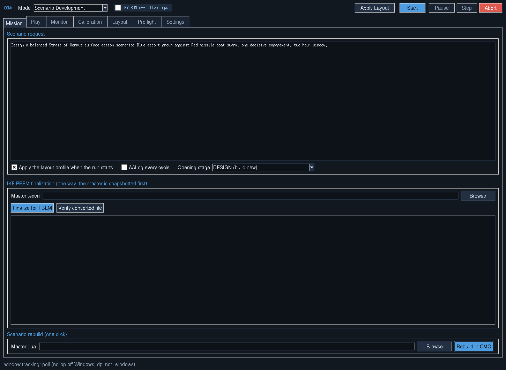

# CMO LLM Bridge


**CONN** is a desktop control panel that connects an AI chat to the **Command: Modern Operations (CMO)** Lua Script Console. It lets an LLM help build, test and refine scenarios while checking what CMO actually returns.

Instead of just producing Lua to copy by hand, CONN can carry a request through **design → execute → test → review → improve**, with the operator able to pause or stop the process.

## What it can do

- **Scenario creation and editing:** Generate and execute CommandLua, inspect a loaded scenario, test changes and refine them.
- **Live feedback:** Return CMO console results to the LLM rather than relying on its assumptions.
- **Local CMO reference:** Use included Lua documentation, platform lookups and database tools to reduce invented commands or IDs.
- **Desktop control:** Arrange windows, calibrate screen targets, inspect progress and save a record of each run.
- **Play options:** Monitor normal play or use LLM-assisted and turn-based modes with the separately installed IKE framework.



## Get started

**You need:** Windows, Python with Tkinter, Command: Modern Operations with its Lua Script Console, and an LLM chat window. CONN controls the visible chat and console; it does **not** require a direct LLM API key.

Download and extract the project, then open PowerShell in the extracted folder. Run these two commands:

```powershell
python -m pip install -r requirements.txt
python conn.py
```

Once CONN opens:

1. Open CMO, its Lua console and your LLM chat. In CONN, identify the windows and calibrate the six required targets.
2. Run **Preflight** and rehearse with **DRY RUN** on (amber interface).
3. When the targets are correct, switch to live mode, enter your scenario request and press **Start**.

**First-time calibration is required.** Follow the [Setup Guide](docs/SETUP.md) before allowing live input.

## Modes

| Mode | Purpose |
| --- | --- |
| **Scenario Development** | Build, test and refine a scenario |
| **Normal Play** | Play manually while CONN monitors |
| **Player vs LLM** | Play against an LLM-controlled opponent |
| **LLM vs LLM** | Let two model commanders take turns |
| **Head to Head PBEM** | Exchange turns using IKE |

The last three modes depend on the separate [IKE project](https://github.com/musurca/IKE) and additional configuration. CMO editions differ in their Lua simulation-control functions; CONN can use calibrated UI controls when needed.

## Scenarios by the author

Examples of the author's CMO scenario work using a CONN-assisted design and scripting workflow:

- [**Orbittoblast**](https://steamcommunity.com/sharedfiles/filedetails/?id=3830546106) — orbital warfare, debris and effects on the conflict below.
- [**Election Day Surprise**](https://steamcommunity.com/sharedfiles/filedetails/?id=3827337947) — a decision-driven Middle East escalation crisis.
- [**Surovikin's Return: The Fortress Belt**](https://steamcommunity.com/sharedfiles/filedetails/?id=3813282207) — a four-part Donbas campaign with drones, electronic warfare and linked choices.
- [**Hormuz 2026: The Southern Route**](https://steamcommunity.com/sharedfiles/filedetails/?id=3808807124) — convoy protection, mines and escalation in the Strait of Hormuz.

These are separate Steam Workshop releases; **CONN is not required to play them**. See the [Scenario Gallery](docs/SCENARIOS.md).

## Help

- [**Setup Guide**](docs/SETUP.md) — install, window detection and calibration.
- [**Using CONN**](docs/CONN.md) — controls, modes, workflow and common problems.
- [**Scenario Gallery**](docs/SCENARIOS.md) — published CMO examples.
- [**Project Wiki**](https://github.com/jheinrichk/Command-Modern-Operations-CMO-LLM-Bridge/wiki) — additional reference.

**Important:** CONN can execute real changes in CMO. Use a copy of a scenario while testing. Platform names alone do not establish valid numeric database IDs or loadouts; verify these against the installed CMO database. This is an independent community project, not an official Matrix Games/Slitherine application.
