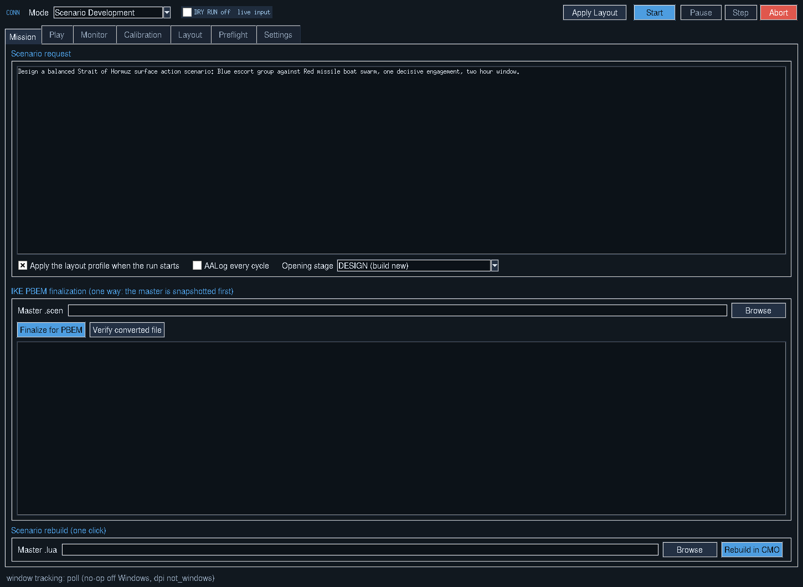

# Using CONN

[Back to overview](../README.md) · [Setup Guide](SETUP.md) · [Scenario Gallery](SCENARIOS.md)

CONN is the main control panel for CMO LLM Bridge. It transfers Lua from an LLM chat to the CMO Lua Script Console, reads actual console output, and returns that output to the model so the next step is based on observed results.

```powershell
python conn.py
```



## The controls

| Control or area | What it does |
| --- | --- |
| **DRY RUN** | Amber: rehearse without live clicks, input or Lua execution. Blue/dark: live input |
| **Mission** | Enter the scenario request and select the opening stage |
| **Mode** | Choose scenario development, normal play or a supported turn-based mode |
| **Layout** | Arrange and restore the CMO, Lua console, chat and CONN windows |
| **Calibration** | Mark the on-screen targets for copy, paste, execution and output reading |
| **Monitor** | Show the current step, Lua sent, console output, status and errors |
| **Play** | Set commanders and options for turn-based modes |
| **Preflight** | Check windows, anchors, folders and required resources before starting |
| **Settings** | Configure timings, chat matching, attachment handling and other controls |
| **Start / Pause / Step / Abort** | Run the workflow, hold it for inspection, advance manually or stop |

CONN provides on-screen help tooltips. The Monitor can be undocked as a narrow always-on-top panel.

## Scenario creation

A request normally follows this sequence:

```text
DESIGN → EXECUTE → TEST → EVALUATE → REFINE → RETEST → REPORT
```


1. **Design:** The LLM proposes a Lua action based on the request and local CommandLua references.
2. **Execute:** CONN checks and sends the script to CMO.
3. **Test:** When appropriate, CMO advances through a selected time window.
4. **Evaluate:** CMO's actual results are returned for inspection.
5. **Refine:** The LLM addresses observed errors or adjusts the scenario, then retests.
6. **Report:** The run ends with a summary and record of the executed steps.

For a **loaded scenario**, choose **AUDIT** to inspect it before changing anything. A failed script generally prompts a repair cycle instead of being treated as success.

CONN depends on the particular CMO edition and Lua console behavior. A successful-looking LLM message does not prove a script executed; use the returned CMO output.

## Play modes

| Mode | What happens | Requirements |
| --- | --- | --- |
| Scenario Development | CONN executes a design/testing workflow | CMO + LLM chat |
| Normal Play | The human plays and CONN monitors | CMO |
| Player vs LLM | An LLM makes orders for an opponent | IKE and calibration |
| LLM vs LLM | Two model commanders alternate under checks | IKE and calibration |
| Head to Head PBEM | Turns are exchanged as save files | IKE and calibration |

[IKE](https://github.com/musurca/IKE) is an independent project and is **not included**. CONN's IKE conversion safeguards are designed to preserve the original scenario by working on a copy. These modes require working third-party files, paths and relevant controls.

## Local knowledge

CONN uses an included CommandLua reference, example recipes, a retrieval index and platform/database lookup material. This helps the model use known function names and reduces unsupported guesses.

**Platform names are not authoritative DBIDs.** When adding units or choosing aircraft loadouts, use IDs verified against the correct installed CMO database. The included data and extraction tools support this work.

## What makes a run safer

- **Dry Run** rehearses the interface before live execution.
- **Preflight** identifies missing windows, unresolved calibration targets and required resources.
- **Syntax and API checks** screen generated Lua before injection.
- **Side and editor restrictions** limit certain actions in play modes.
- **Output matching** helps distinguish a new CMO response from older console text.
- **Pause, Step and Abort** keep the operator in control; **Ctrl+Alt+X** is the default abort shortcut.

These checks reduce mistakes but cannot guarantee that generated Lua is logically correct. Always use a working copy of a scenario for testing.

## Where to see the result

The **Monitor** displays progress and recent Lua/CMO feedback. Each run also saves a session with an event history, full transcript, Lua scripts, changes between scripts and a summary report. These are useful when a run fails or when reviewing what actually changed.

## Common problems

**CONN cannot identify the chat or console.** Check each window's title and the chat window matching setting. Then refresh windows.

**The wrong control is clicked.** Turn on Dry Run. Check the calibration overlay, window binding and any change in browser zoom.

**The model response cannot be copied.** Make a Lua code block visible and recalibrate its Copy button. A whole-page selection is not a reliable substitute.

**Lua returns an error.** Check the actual CMO output and whether the function/DBID is valid for that edition and database. Let the model repair the error in a bounded cycle.

**A run appears stalled.** Use Pause, review the Monitor and check chat reply waits, attachment handling and the six required anchors. Abort when a calibration issue might cause an unintended action.

**The mode needs IKE.** Install IKE separately and configure its conversion and turn controls before using PBEM or LLM-opponent modes.

**Setup instructions:** [Setup Guide](SETUP.md).
