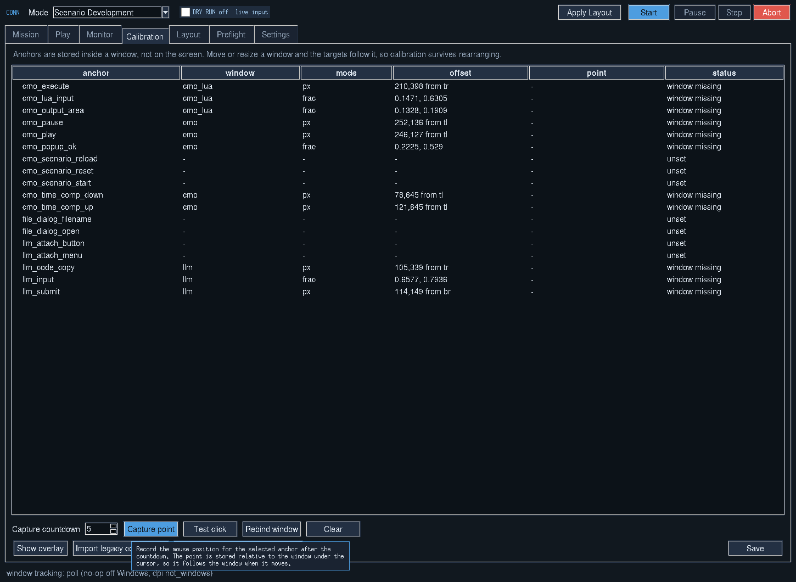

# Setup Guide

[Back to overview](../README.md) · [Using CONN](CONN.md)

CONN controls a **visible LLM chat window** and **CMO's Lua Script Console** through calibrated desktop actions. Perform this setup once for each distinct desktop/browser layout, and repeat calibration when controls move.

## 1. Install and launch

On Windows, install Python with Tkinter and open PowerShell in the extracted project folder:

```powershell
python -m pip install -r requirements.txt
python conn.py
```

Open Command: Modern Operations with a disposable scenario, its **Lua Script Console**, and your chosen AI chat in a separate browser window. Keep all windows unminimized. No direct provider API key is required.

## 2. Identify your windows

Start CONN once and save its settings. In the generated `bridge_config.json`, set `windows.llm.title_regex` to a distinctive part of the real chat window title (for example, `ChatGPT`). The initial `LLM` value is only a placeholder. Restart CONN.

In **Layout → Refresh windows**, confirm that the entries for `llm`, `cmo`, `cmo_lua` and `conn` each identify the correct window. The separate Settings option **LLM tab must contain** provides an additional check.

## 3. Arrange the desktop

Leave **DRY RUN on** while setting up. Position the CMO window, Lua console, browser and CONN so the buttons you need are visible. In **Layout**, use **Capture current** to save the arrangement, and select that layout as active. **Apply Layout** restores window positions.

The layout manages window positions. Calibration, below, tells CONN where to click *within* them.

## 4. Calibrate six required targets

In **Calibration**, select each anchor and press **Capture point**. During the countdown, hold the pointer over the indicated control.

| Anchor | Point to |
| --- | --- |
| `llm_input` | AI chat message box |
| `llm_submit` | Chat Send button |
| `llm_code_copy` | Copy button of a visible Lua code block in chat |
| `cmo_lua_input` | Editable Lua script input pane |
| `cmo_execute` | Lua console Execute/Run button |
| `cmo_output_area` | Lua console results pane |

Use **Show overlay** to confirm the positions. The anchors are saved relative to their windows, but browser zoom or a changed console layout can still shift controls.



If you intend to control simulation playback through the UI, also calibrate the applicable play, pause and time-compression buttons. Scenario reset/reload controls start unset and must not be guessed. The default chat attachment shortcut is not supported by every browser; choose and calibrate an attachment method that works in yours.

## 5. Check before a live run

1. Run **Preflight → Run checks** and resolve blocking findings.
2. Rehearse with **DRY RUN** on. Amber means no real click, paste or Lua injection.
3. Switch off Dry Run only after checking your targets; the interface turns dark blue.
4. Select the mode and opening stage, type the request and press **Start**.
5. Use **Pause**, **Step** or **Abort** to control the run. The default global abort shortcut is **Ctrl+Alt+X**.

For an existing scenario, the **AUDIT** opening stage is generally the appropriate first step. Work on a copy until you trust the result.

## If something moves or fails

- **Wrong window found:** Check window titles and `windows.llm.title_regex`.
- **Wrong click:** Turn Dry Run on and recapture the affected anchor.
- **Nothing copied from chat:** Ensure a Lua code block is visible and its Copy button is calibrated.
- **Attachment fails:** Check the chat application's attachment method and Settings.
- **Lua errors:** Inspect the output in the CONN Monitor and the saved session.

Recalibrate after changes to display scaling, browser zoom, window arrangement or chat interface.

[Using CONN](CONN.md) explains the operating modes and workflow.
