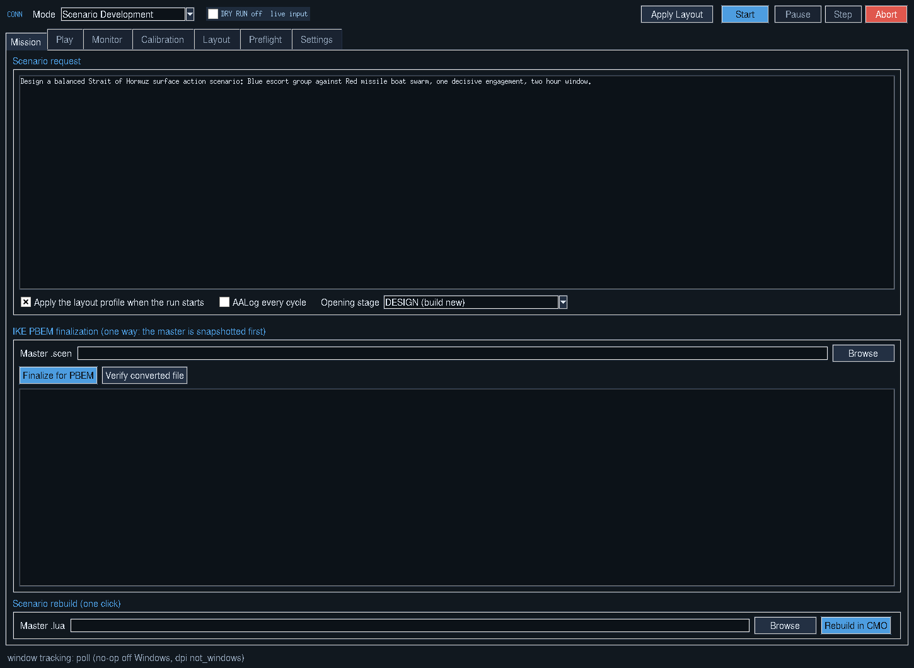
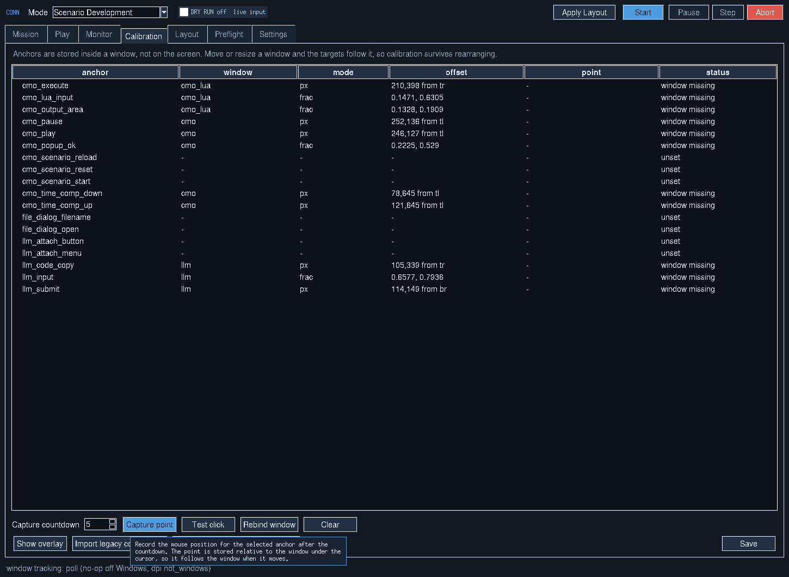

# CONN Interface

[[Home]] · [[Getting Started|Getting-Started]] · [[Scenario Development Workflow|Scenario-Development-Workflow]]

CONN is the desktop control surface replacing the older standalone console and calibration interface. The dark blue palette means **live input**; an amber interface means **DRY RUN**, with external actions suppressed.

## Header and modes

The header offers operating mode selection, **Apply Layout**, **Start**, **Pause**, **Step** and **Abort**. Five modes appear in the current documentation:

| Mode | Purpose | IKE |
| --- | --- | --- |
| Scenario Development | Model builds, tests and improves a scenario | Not required |
| Normal Play | Human operates; CONN monitors without injecting | Not required |
| Player vs LLM | Human controls one side, model commands opponent | Required |
| LLM vs LLM | Two model commanders alternate under an arbiter | Required |
| Head to Head PBEM | Players exchange save files under the turn workflow | Required |

Play-mode support is a configured workflow; it should not be mistaken for a guarantee that any uncalibrated installation automatically runs multiplayer.

## Tabs and what they control

| Area | Function |
| --- | --- |
| Mission / Scenario Request | Request, opening stage, active mode and optional layout application |
| Play | Commander objectives, profiles, ROE, order budgets and turn controls |
| Monitor | Current stage, current script/output, timing, counts, error/retry summaries |
| Calibration | Capture, test, rebind and overlay window-relative click anchors |
| Layout | Discover, capture, select and apply multi-window arrangements |
| Preflight | Validate prerequisites, writable paths and critical anchors |
| Settings | Timings, chat matching, clipboard, input routing, stop rules and safety |
| IKE finalization | Snapshot, convert a copy and verify an independently installed IKE conversion |

Descriptions correspond to the documented application; names may vary slightly between builds.

## Six-step transaction

1. Click the Copy button on a model's Lua code block.
2. Paste into the CMO Lua console input.
3. Execute in the console.
4. Read the new console output.
5. Paste the output into the LLM message field.
6. Submit so the model can act on observed results.

Each injected command is wrapped in unique `CONN_BEGIN:` and `CONN_END:` output markers; CONN reads output for that transaction rather than treating older text in a growing console pane as a new result.

## Calibration illustration

The overlay and live window tracking support repositioned windows, but chat page zoom and console panel layout changes can still invalidate target locations. Preflight names missing or obstructed anchors rather than guessing a click.

## Live monitor and session records

The monitor includes stage chips, run/turn/error counters, timers, live Lua and output excerpts, retrieval hits and a log tail. It can undock into an always-on-top strip. The event stream, full transcript, deployed Lua versions, diffs and report are retained under `SESSIONS`.

## Closing a run

A run can finish when CMO actually prints `BRIDGE_DONE:
`, the workflow reaches DONE, the model reports an actionable halt, stop counters trip, the cycle budget is consumed or the operator aborts. A Lua failure normally routes into repair; the engine should not declare success merely because the model wrote completion text in an unexecuted script.

See [docs/CONN.md](https://github.com/jheinrichk/Command-Modern-Operations-CMO-LLM-Bridge/blob/main/docs/CONN.md) for the detailed control contract.
