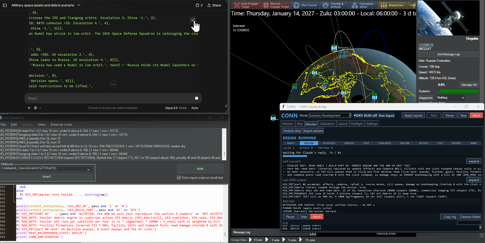

# CMO LLM Bridge

**CONN — an LLM-assisted control surface for Command: Modern Operations**



CMO LLM Bridge connects an LLM chat interface to the **Command: Modern Operations (CMO)** Lua Script Console. Its CONN desktop control panel manages the handoff: it sends grounded Lua instructions into CMO, reads the actual results, returns them to the model and repeats. The objective is not merely to generate Lua snippets but to let the model assist with a complete, observable **design → deploy → test → evaluate → refine → retest → report** workflow.

The application uses local CommandLua reference material and database lookups rather than trusting the model to invent API calls, unit identifiers or loadouts. CONN can also monitor a human player or orchestrate play modes and IKE-based PBEM workflows, subject to configuration and third-party requirements.

**Project:** [GitHub repository](https://github.com/jheinrichk/Command-Modern-Operations-CMO-LLM-Bridge) · **Author:** [jheinrichk](https://github.com/jheinrichk) · **Simulation:** [Command: Modern Operations](https://store.steampowered.com/app/1076160/Command_Modern_Operations/)

> **Project scope:** CONN is an external desktop automation and scripting bridge. It is not an official CMO component, is not a direct LLM-provider API integration and is not required to play the author's exported Workshop scenarios.

## Start here

1. [[Getting Started|Getting-Started]] — install, configure, calibrate, rehearse and start a run.
2. [[CONN Interface|CONN-Interface]] — controls, tabs, layouts, modes and monitoring.
3. [[Scenario Development Workflow|Scenario-Development-Workflow]] — the end-to-end iteration loop.
4. [[Knowledge Pack and RAG|Knowledge-Pack-and-RAG]] — local references, DBID verification and learned lessons.
5. [[Automation and Safety|Automation-and-Safety]] — preflight, guarded injection and recoverable failures.
6. [[Play Modes and IKE|Play-Modes-and-IKE]] — player, LLM-versus-LLM and PBEM operations.
7. [[Scenario Showcase|Scenario-Showcase]] — published work by jheinrichk.
8. [[Architecture|Architecture]] and [[Troubleshooting|Troubleshooting]] — reference and support.

## What CONN does

| Capability | How it works |
| --- | --- |
| Scenario construction | LLM designs Lua scripts; CONN executes them in the CMO console |
| Closed-loop testing | Read console output, advance a simulation window and evaluate actual results |
| Local grounding | Retrieval from a bundled CommandLua knowledge pack and platform database |
| Controlled iteration | Targeted refinements, repeated playtests and progress tracking |
| Transparent operation | Live monitor, step/pause/abort, transcript, script history and report |
| Window management | Saved desktop layouts and window-relative calibration anchors |
| Safety controls | Dry Run, API symbol checks, Lua checks, side/editor locks and stop conditions |
| Play and PBEM | Normal Play, Player vs LLM, LLM vs LLM and IKE-assisted handoff |

## Example scenarios built with the author's bridge-assisted workflow

The following are **published CMO works by jheinrichk**. Their Workshop pages are the authoritative sources for downloadable scenario files, current versions and gameplay details; they are demonstrations of the kind of scenario scripting and design workflow CONN supports, not files bundled with the bridge.

| Released title | Focus | Play |
| --- | --- | --- |
| [Orbittoblast](https://steamcommunity.com/sharedfiles/filedetails/?id=3830546106) | Space-domain escalation, satellite loss and orbital debris affecting ground operations | Russia, Ukraine, or US/NATO |
| [Election Day Surprise](https://steamcommunity.com/sharedfiles/filedetails/?id=3827337947) | High-stakes decisions and escalation in a Gulf/Middle East crisis | United States or Iran; solo/PBEM/hotseat |
| [Surovikin's Return: The Fortress Belt](https://steamcommunity.com/sharedfiles/filedetails/?id=3813282207) | Four-chapter Donbas campaign, drones, EW and persistent campaign state | Ukraine or Russia |
| [Hormuz 2026: The Southern Route](https://steamcommunity.com/sharedfiles/filedetails/?id=3808807124) | Convoy protection, mine clearance, regional escalation and restraint | United States or Iran |

See [[Scenario Showcase|Scenario-Showcase]] for detailed descriptions, databases, release links and Matrix Games forum discussions.

## The basic design loop

```text
User request
    ↓
CONN + local RAG / CommandLua reference
    ↓
LLM generates a bounded Lua step
    ↓
Syntax and API checks → calibrated CMO Lua console
    ↓
Real console result and simulation state
    ↓
LLM evaluates → patch and retest as needed
    ↓
Report + saved session artifacts
```

The workflow is deliberately visible: a generated script must be evaluated against what **CMO actually returned**, not simply against what the model expected.

## Requirements at a glance

- Windows for real desktop/window automation, CMO and its Lua Script Console.
- Python with Tkinter; install dependencies from [requirements.txt](https://github.com/jheinrichk/Command-Modern-Operations-CMO-LLM-Bridge/blob/main/requirements.txt).
- An LLM chat interface that can exchange code blocks; calibrate the browser controls for that interface.
- Local CMO database extraction for authoritative DBIDs and aircraft loadouts when constructing units.
- IKE separately installed **only** for modes that require it.

**Launch:** `python conn.py`. Keep **DRY RUN on** until window tracking, six required anchors and Preflight all pass.

## Source documentation

The repository's maintained technical references are [CONN](https://github.com/jheinrichk/Command-Modern-Operations-CMO-LLM-Bridge/blob/main/docs/CONN.md), [SETUP](https://github.com/jheinrichk/Command-Modern-Operations-CMO-LLM-Bridge/blob/main/docs/SETUP.md) and [WORKFLOW](https://github.com/jheinrichk/Command-Modern-Operations-CMO-LLM-Bridge/blob/main/docs/WORKFLOW.md). These documents and the source code govern any behavior not covered here.
